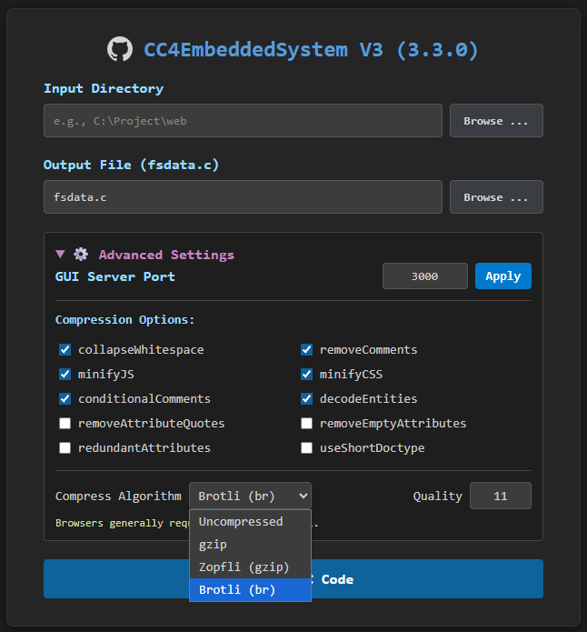

# CC4EmbeddedSystem V3

A TypeScript/Node.js rewrite of [lwIP makefsdata](https://github.com/m-labs/lwip/tree/master/src/apps/httpd/makefsdata) that converts web assets into `fsdata.c`, with a local GUI and headless CLI.

- Requires **Node.js 22.13.0 or newer**.
- Optimizes HTML, CSS, JavaScript, and SVG; supports `none`, `gzip`, `brotli`, and gzip-compatible `zopfli` storage.
- A fresh configuration defaults to **Brotli quality 11**. Saved settings and explicit selections take precedence.

Browsers generally require **HTTPS** for `Content-Encoding: br` (Brotli). For HTTP-only device pages, select gzip or Zopfli.

## Sources

- [GitHub](https://github.com/LunaticGhoulPiano/CC4EmbeddedSystem)
- [npm](https://www.npmjs.com/package/cc4-embedded-system)
- [Documentation](https://lunaticghoulpiano.github.io/documentations/cc4-embedded-system/)

## Quick start

```bash
npm install -g cc4-embedded-system
cc4es
```

The GUI runs at `http://localhost:3000` by default.



```bash
# Headless conversion with Brotli
cc4es --headless --src "C:/Project/web" --dst "C:/Project/fsdata.c" --compression brotli --brotli-quality 11

# gzip for an HTTP-only device
cc4es --headless --src "C:/Project/web" --dst "C:/Project/fsdata.c" --compression gzip --gzip-level 9

# Show available options and the saved configuration path
cc4es --help
cc4es --config-path
```

`--compression none` disables storage compression while retaining asset optimization. Byte-preserving generator calls use `minifyOpts: false`; the project demos use this setting.

## Development

Run from `V3`. Use the source checkout for changes not yet published to [npm](https://www.npmjs.com/package/cc4-embedded-system).

```bash
npm ci
npm test
npm run build
npm run dev
```

## Project demos

DuetWebControl, ESP3D-WEBUI, and WLED are pinned submodules under `demo/src/`. Revisions and settings are defined in [demo/projects.mjs](./demo/projects.mjs). Their source checkouts must be present before preparation.

```bash
# Install upstream build dependencies and prepare production assets
npm run demo:prepare -- --install

# Generate C files and compare source/raw/decoded payloads
npm run demo:build
npm run demo:test

# Serve WLED with simulated device APIs; stop with Ctrl+C
npm run demo:serve -- --project WLED --compression gzip --port 8080
```

Demo dependencies and caches stay under `demo/.cache/`. After the first preparation, use `npm run demo:prepare` to rebuild with installed dependencies.

Each `demo/dst/<project>/` contains:

```text
fsdata_raw.c
fsdata_gzip_level9.c
fsdata_brotli_quality11.c
fsdata_zopfli_iterations100.c
```

Payload tests verify source/raw equality, decompression, and response headers. Target lwIP compilation, HTTP server integration, and real hardware behavior still require separate verification.

Third-party attribution is included in [licenses/](./licenses/).
